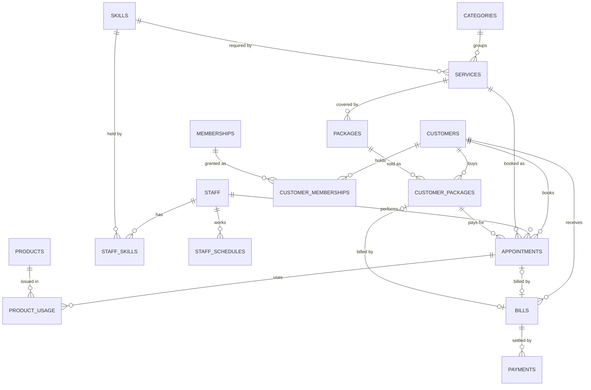

# Project 66 – Salon and Spa Appointment Management System

## How to run
1. Install MySQL 8.0.16+ and Python 3.9+ (`pip install mysql-connector-python`).
2. `mysql -u root -p < schema.sql`
3. `mysql -u root -p salon_spa < sample_data.sql`
4. `mysql -u root -p salon_spa < queries.sql` (demo queries)
5. Set `DB_PASSWORD`, then `python app.py`

| File | Review |
|---|---|
| README.md (sections 1-4) | Review 1, Review 2 (normalization, data dictionary) |
| schema.sql | Review 1 (schema), Review 2 (DDL, constraints, triggers) |
| sample_data.sql, queries.sql | Review 2 |
| app.py | Review 3 |

---
## 1. Problem, scope, objectives (Review 1)
**Problem.** Salons that use paper appointment books suffer double-booked staff, wrong staff for a service, untracked package sessions, untracked product stock and slow billing.

**Scope.** Customer registration, service catalogue, staff skills and schedules, appointment booking, packages and memberships, product use, billing, payments and management reports for a single-branch salon/spa.

**Objectives.**
- Prevent overlapping staff appointments and skill mismatches.
- Track package balances and enforce session limits.
- Deduct product stock and bill accurately (membership discounts).
- Provide reports: appointments, staff utilization, service popularity, package balances, product use, revenue.

**Users and roles.** Receptionist (customers, bookings, billing, payments), Stylist/Therapist (views own schedule, completes services), Manager (reports, catalogue, staff schedules).

**Functional requirements.**
- FR1 Register / search / update customers.
- FR2 Manage services, categories, skills, staff, schedules.
- FR3 Book / cancel / reschedule appointments with automatic skilled-staff assignment.
- FR4 Sell packages; consume and restore sessions.
- FR5 Issue products to an appointment; deduct stock.
- FR6 Generate bill (service + products − membership discount); record payments.
- FR7 Reports.

**Business rules.** (1) No overlapping appointments per staff. (2) Staff must have the skill the service requires. (3) Appointment must lie inside the staff working hours, on a 15-minute slot, and a new booking must be in the future. (4) A package cannot be used beyond its sessions, expiry, owner or service. (5) Payments cannot exceed the bill. (6) Products cannot be issued beyond stock.

## 2. ER diagram (Review 1)

## 3. Relational schema (Review 1)
(PK underlined = marked **bold**, FK in *italics*)

- CUSTOMERS(**customer_id**, full_name, phone, email, registered_on)
- CATEGORIES(**category_id**, category_name)
- SKILLS(**skill_id**, skill_name)
- SERVICES(**service_id**, *category_id*, *required_skill_id*, service_name, duration_min, price, is_active)
- STAFF(**staff_id**, full_name, phone, email, hire_date, is_active)
- STAFF_SKILLS(**staff_id**, **skill_id**) – both FK
- STAFF_SCHEDULES(**schedule_id**, *staff_id*, day_of_week, start_time, end_time) – UNIQUE(staff_id, day_of_week)
- PACKAGES(**package_id**, package_name, *service_id*, total_sessions, price, validity_days, is_active)
- CUSTOMER_PACKAGES(**customer_package_id**, *customer_id*, *package_id*, purchase_date, expiry_date, sessions_remaining)
- MEMBERSHIPS(**membership_id**, membership_name, discount_percent, fee, duration_days)
- CUSTOMER_MEMBERSHIPS(**customer_membership_id**, *customer_id*, *membership_id*, start_date, end_date)
- APPOINTMENTS(**appointment_id**, *customer_id*, *staff_id*, *service_id*, *customer_package_id*, start_datetime, end_datetime, status)
- PRODUCTS(**product_id**, product_name, unit_price, stock_qty)
- PRODUCT_USAGE(**usage_id**, *appointment_id*, *product_id*, quantity, unit_price)
- BILLS(**bill_id**, *customer_id*, *appointment_id*, *customer_package_id*, bill_date, service_amount, product_amount, package_amount, discount_amount, total_amount, status)
- PAYMENTS(**payment_id**, *bill_id*, amount, method, paid_at)

## 4. Normalization to 3NF (Review 2)
**Starting point (UNF)** – one sheet per visit:
`(customer_name, phone, service_name, service_price, duration, category, staff_name, staff_skills, appointment_time, package_name, sessions_left, product_name, product_qty, product_price, bill_total, payment_amount)`

**1NF** – remove repeating groups (several skills per staff, several products per visit, several payments per bill) → separate rows/tables: STAFF_SKILLS, PRODUCT_USAGE, PAYMENTS.

**2NF** – remove partial dependencies on composite keys. Example: in (appointment_id, product_id) → quantity, but product_name and unit_price depend on product_id alone → moved to PRODUCTS. Likewise skill_name depends on skill_id alone → SKILLS.

**3NF** – remove transitive dependencies:
- appointment → service_id → (service_name, price, duration, category) → SERVICES and CATEGORIES
- appointment → customer_id → (name, phone) → CUSTOMERS
- appointment → staff_id → staff details → STAFF
- service → required_skill_id → skill_name → SKILLS

**Functional dependencies (per table)**
| Table | Functional dependencies |
|---|---|
| CUSTOMERS | customer_id → all; phone → customer_id; email → customer_id |
| CATEGORIES | category_id → category_name; category_name → category_id |
| SKILLS | skill_id → skill_name |
| SERVICES | service_id → category_id, required_skill_id, service_name, duration_min, price, is_active |
| STAFF | staff_id → all; phone → staff_id |
| STAFF_SKILLS | (staff_id, skill_id) → ∅ (all-key) |
| STAFF_SCHEDULES | schedule_id → all; (staff_id, day_of_week) → start_time, end_time |
| PACKAGES | package_id → package_name, service_id, total_sessions, price, validity_days |
| CUSTOMER_PACKAGES | customer_package_id → customer_id, package_id, purchase_date, expiry_date, sessions_remaining |
| MEMBERSHIPS / CUSTOMER_MEMBERSHIPS | membership_id → name, discount, fee, duration; cm_id → customer_id, membership_id, start_date, end_date |
| APPOINTMENTS | appointment_id → customer_id, staff_id, service_id, customer_package_id, start_datetime, end_datetime, status |
| PRODUCTS | product_id → product_name, unit_price, stock_qty |
| PRODUCT_USAGE | usage_id → appointment_id, product_id, quantity, unit_price |
| BILLS | bill_id → all; appointment_id → bill_id; customer_package_id → bill_id |
| PAYMENTS | payment_id → bill_id, amount, method, paid_at |

In every table each determinant is a candidate key (or the table is all-key), so the schema is in **BCNF, and therefore 3NF**.

**Deliberate, documented redundancy (snapshots).** These columns can be derived, but are stored so history stays correct when prices change; they are maintained by triggers/procedures, never typed by hand:
`appointments.end_datetime` (start + duration), `product_usage.unit_price` (price when issued), `bills.*_amount / total_amount` (checked by a CHECK constraint), `customer_packages.sessions_remaining` (running balance), `bills.status`.

## 5. Data dictionary (Review 2)
| Table | Column | Type | Constraints |
|---|---|---|---|
| customers | customer_id | INT | PK, auto-increment |
| | full_name | VARCHAR(100) | NOT NULL |
| | phone | CHAR(10) | NOT NULL, UNIQUE, CHECK `^[6-9][0-9]{9}$` |
| | email | VARCHAR(120) | UNIQUE, CHECK pattern |
| | registered_on | DATE | NOT NULL, DEFAULT today |
| categories | category_name | VARCHAR(60) | NOT NULL, UNIQUE |
| skills | skill_name | VARCHAR(60) | NOT NULL, UNIQUE |
| services | category_id, required_skill_id | INT | FK, NOT NULL |
| | duration_min | INT | CHECK 15–480 and multiple of 15 |
| | price | DECIMAL(10,2) | CHECK ≥ 0 |
| staff | phone | CHAR(10) | UNIQUE, CHECK pattern |
| | is_active | TINYINT(1) | DEFAULT 1 |
| staff_skills | (staff_id, skill_id) | INT, INT | composite PK, both FK |
| staff_schedules | day_of_week | TINYINT | CHECK 1–7; UNIQUE(staff_id, day_of_week) |
| | start_time, end_time | TIME | CHECK end_time > start_time |
| packages | total_sessions | INT | CHECK > 0 |
| | validity_days | INT | CHECK > 0, DEFAULT 90 |
| customer_packages | sessions_remaining | INT | CHECK ≥ 0 |
| | expiry_date | DATE | CHECK ≥ purchase_date |
| memberships | discount_percent | DECIMAL(5,2) | CHECK 0–100 |
| appointments | start_datetime | DATETIME | NOT NULL, CHECK 15-minute slot |
| | end_datetime | DATETIME | set by trigger, CHECK > start |
| | status | ENUM | BOOKED/COMPLETED/CANCELLED/NO_SHOW, DEFAULT BOOKED |
| products | stock_qty | INT | CHECK ≥ 0, DEFAULT 0 |
| product_usage | quantity | INT | CHECK > 0 |
| bills | appointment_id / customer_package_id | INT | UNIQUE; CHECK exactly one is set |
| | total_amount | DECIMAL(10,2) | CHECK = service + product + package − discount |
| | status | ENUM | UNPAID/PARTIAL/PAID |
| payments | amount | DECIMAL(10,2) | CHECK > 0 |
| | method | ENUM | CASH/CARD/UPI |

## 6. How each business rule is enforced
| Rule | Where |
|---|---|
| No overlapping staff appointments | `sp_validate_appointment` ← `trg_appt_bi` / `trg_appt_bu`; index `idx_ap_staff_time`; row lock `FOR UPDATE` in app |
| Skill match | `sp_validate_appointment` |
| Valid appointment time | schedule check + 15-min CHECK + future-only trigger |
| Package-session limit | CHECK `sessions_remaining >= 0` + checks in `trg_appt_bi`; session deducted in `trg_appt_ai`, restored in `trg_appt_au` |
| Stock | `trg_usage_bi`, `trg_usage_ai`, CHECK `stock_qty >= 0` |
| Payment ≤ bill | `trg_pay_bi`; status sync in `trg_pay_ai` |

## 7. Viva-voce quick answers
- **Why triggers?** Rules must hold no matter which client (app, SQL console) writes data.
- **Why is end_datetime NULLable?** MySQL validates NOT NULL on omitted columns before BEFORE triggers run; the trigger always fills it.
- **Why store bill totals if derivable?** Prices change; a bill is a historical snapshot (documented denormalization, guarded by a CHECK).
- **Concurrency?** Transactions + `SELECT ... FOR UPDATE` on the staff row before booking.
- **Indexes?** Customer name search, staff/time overlap lookup, appointment date/status, bill date, payments by bill.
- **Test ideas (Review 3):** run the commented failing statements at the end of `queries.sql`; book two overlapping slots from the app; use a package until it is exhausted.

## 8. Verification
The whole package was executed on MySQL 8.0 and Python: see `TEST_RESULTS.md` (rule tests, billing checks, app tests).
Fixes made during testing: payments in `sample_data.sql` are staged in a temp table (MySQL forbids reading `bills` in the statement that fires a trigger updating it); `app.py` now exits cleanly on Ctrl+C / end of input.

